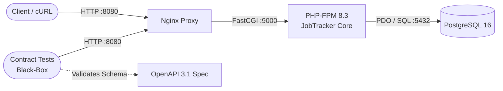

# Backbone Project: JobTracker Core

### Backbone Project Definition (JobTracker Core)

Modular and lightweight REST API for managing the lifecycle of technical job postings and applications (application stages, notes, tracking, and conversion metrics). Designed with a *contract-first* approach using the OpenAPI 3.1 specification and verified via black-box HTTP tests to decouple validation from internal framework implementation. Built incrementally across four phases: Phase 1 (Docker Environment, OpenAPI, and Healthcheck), Phase 2 (Transactional Job CRUD and Idempotency), Phase 3 (OWASP Security, Hashing, and Tokens), and Phase 4 (Conversion Metrics and Observability).



## Environment Variables

Copy the `.env.example` template and configure the following parameters in your `.env` file before starting the containers:

| Variable | Description | Example Value | Required |
| :--- | :--- | :--- | :---: |
| `DB_HOST` | Database service name in Docker | `db` | Yes |
| `DB_PORT` | PostgreSQL internal port | `5432` | Yes |
| `DB_DATABASE` | Database name | `db_name` | Yes |
| `DB_USERNAME` | PostgreSQL database user | `db_user` | Yes |
| `DB_PASSWORD` | PostgreSQL database password | `db_user_pass` | Yes |
| `TOKEN_WRITE` | Bearer token granting write permissions | `1111111111111111111111111...` | Yes |
| `TOKEN_READ` | Bearer token granting read-only permissions | `000000000000000000000000...` | Yes |

**Security Warning on Tokens:**  
The values provided in `.env.example` (such as `111...` or `000...`) are **placeholder defaults intended solely for local development** and are publicly exposed in the repository. **Never use them in shared, staging, or production environments**, as they would allow anyone with access to the codebase to authenticate and read or modify your data.

**Note on Generating Tokens:**  
To generate valid 64-character hex tokens without requiring PHP installed on your local host, use the `app` container:
```bash
docker compose run --rm --no-deps app php -r "echo bin2hex(random_bytes(32)) . PHP_EOL;"
```

If you prefer to generate tokens with PHP directly on your local machine, run:
```bash
php -r "echo bin2hex(random_bytes(32)) . PHP_EOL;"
```


## Quickstart

Navigate to the app/ directory where the Docker configuration resides, set up your environment file, and start the services:

```bash
# 1. Navigate to the application directory
cd app

# 2. Copy the environment configuration template
cp .env.example .env

# 3. Build images and start containers in the background
docker compose up -d --build

# 4. Seed the database with initial test records
docker compose run --rm app php bin/seed-jobs.php
```

## Running Tests
The project includes unit validations for internal domain/infrastructure logic (PHPUnit) and black-box contract tests for external HTTP verification.

### Unit Tests (PHPUnit)
```bash
docker compose run --rm app vendor/bin/phpunit
```

### Contract Tests (Black-Box Testing)
```bash
docker compose run --rm contract-tests
```

## Validating Contract Changes
Following the Contract-First methodology using OpenAPI 3.1, any change made to contracts/openapi.yaml must be validated to prevent syntax or schema errors by running:
```bash
npx @redocly/cli lint contracts/openapi.yaml
```

## Usage Examples (cURL)

### 1. `201 Created` - Create a Job Posting
```bash
curl -i -X POST http://localhost:8080/api/v1/jobs \
  -H "Content-Type: application/json" \
  -H "Authorization: Bearer <TOKEN_VALIDO>" \
  -H "Idempotency-Key: 550e8400-e29b-41d4-a716-446655440000" \
  -d '{
    "title": "Senior Backend Engineer (PHP)",
    "company": "Acme Tech",
    "status": "APPLIED",
    "salary_max": 85000
  }'
```

### 2. `200 OK` - List Job Postings
```bash
curl -i -X GET "http://localhost:8080/api/v1/jobs" \
  -H "Accept: application/json"
```

Optional query parameters:
- limit: Integer between 1 and 50 (default: 20).
- status: Allowed enum value defined in JobStatus (DRAFT, APPLIED, INTERVIEWING, OFFER, REJECTED).
- cursor: URL-safe Base64 opaque string encoding created_at in microseconds and UUID id for deterministic pagination.


### 3. `409 Conflict` - Duplicate Idempotency Key
Test by executing the following cURL twice (or once if Example 1 was already run with the same key):
```bash
curl -i -X POST http://localhost:8080/api/v1/jobs \
  -H "Content-Type: application/json" \
  -H "Authorization: Bearer <TOKEN_VALIDO>" \
  -H "Idempotency-Key: 550e8400-e29b-41d4-a716-446655440000" \
  -d '{
    "title": "Senior Backend Engineer (PHP)",
    "company": "Acme Tech",
    "status": "DRAFT",
    "salary_max": 85000
  }'
```

### 4. `401 Unauthorized` - Missing or Invalid Token
```bash
curl -i -X POST http://localhost:8080/api/v1/jobs \
  -H "Content-Type: application/json" \
  -H "Idempotency-Key: 550e8400-e29b-41d4-a716-446655440000" \
  -d '{
    "title": "Senior Backend Engineer (PHP)",
    "company": "Acme Tech",
    "status": "INTERVIEWING",
    "salary_max": 85000
  }'
```

### 5. `403 Forbidden` - Insufficient Role Permissions (Read-Only Token)
```bash
curl -i -X POST http://localhost:8080/api/v1/jobs \
  -H "Content-Type: application/json" \
  -H "Authorization: Bearer <TOKEN_USUARIO_SOLO_LECTURA>" \
  -H "Idempotency-Key: 550e8400-e29b-41d4-a716-446655440000" \
  -d '{
    "title": "Senior Backend Engineer (PHP)",
    "company": "Acme Tech",
    "status": "INTERVIEWING",
    "salary_max": 85000
  }'
```

### 6. `422 Unprocessable Entity` - Validation Error
```bash
curl -i -X POST http://localhost:8080/api/v1/jobs \
  -H "Content-Type: application/json" \
  -H "Authorization: Bearer <TOKEN_VALIDO>" \
  -H "Idempotency-Key: 550e8400-e29b-41d4-a716-446655440000" \
  -d '{
    "title": " ",
    "company": "Acme Tech",
    "status": "REJECTED",
    "salary_max": -85000
  }'
```